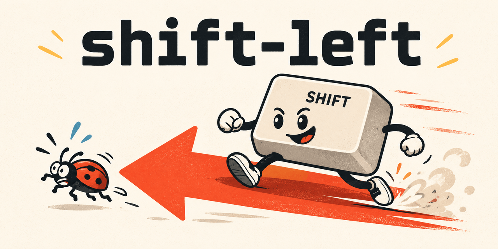

# shift-left

[](https://github.com/piotr-yuxuan/shift-left/releases/latest)
[](https://github.com/piotr-yuxuan/shift-left/actions/workflows/ci.yml)
[](https://github.com/piotr-yuxuan/shift-left?tab=EUPL-1.2-1-ov-file#readme)
[](https://github.com/piotr-yuxuan/shift-left/issues)
[](https://agentskills.io/specification)
[](https://code.claude.com/docs/en/discover-plugins)



Small plugins that help a coding agent write code that would already pass review: design rules that it consults while
it works, a reviewer that it can call on its own change, and a hook that keeps lint and complexity from getting worse.
The skills are packaged both for Claude Code and for the open Agent Skills and Agent Plugins standards, which Codex,
Cursor and GitHub Copilot read. Each plugin can be installed on its own.

<br clear="right">

## The plugins

| Plugin | What it gives the agent | Needs |
|---|---|---|
| [`principles`](plugins/principles) | Three skills: sixteen design rules for clear, maintainable, verifiable code, four guidelines against common LLM coding mistakes, and six moves on concepts. A read-only reviewer agent that checks a change against the first two | nothing |
| [`quality-ratchet`](plugins/quality-ratchet) | A hook that runs Ruff after each Python edit and reports only the problems that the edit introduced | Python 3.14+, git, Ruff |
| [`workflow`](plugins/workflow) | A skill for the life of a change: one plan, one branch and one worktree, an independent review, a merge only on your word | git |
| [`learning`](plugins/learning) | A learning mode, started only by you, in which the agent teaches rather than does | nothing |
| [`coordinator`](plugins/coordinator) | Scripts that record what reviews found and what workflow runs cost | Python 3.14+, git |
| [`code-index`](plugins/code-index) | Hooks that give each linked git worktree a codegraph index of its own when an agent adds it or a session starts in it, and a skill that says how to query it | Python 3.10+, git 2.36+, codegraph |

<details>
<summary>More about each plugin</summary>

**`principles`.** `programming-principles` holds the sixteen design rules, each with a guide. `karpathy-guidelines`
holds four: think before coding, simplicity first, surgical changes, goal-driven execution; it is copied unchanged
from another repository, under MIT. `concept-design` names Daniel Jackson's six moves on concepts, split and merge,
unify and specialize, tighten and loosen, each a trade-off, and reads them for code as candidates to weigh;
`workflow:plans` names it for a plan that makes a move on a concept. The agent `principles-reviewer` reviews one change
against the first two skills in one bounded pass. Give it a plan with acceptance criteria and it checks the change
against them too.

**`quality-ratchet`.** After each edit of a Python file, it runs Ruff with the repository's own configuration, plus
McCabe complexity and the bugbear rules, on the edited file and on its committed version, and reports the difference.
A function already over the complexity threshold may not grow. It prefers the `.venv/bin/ruff` of the repository being
edited to the `ruff` on `PATH`. In a new file, or outside git, every problem counts as introduced.

**`workflow`.** The skill `plans`: small commits with fixed rules for their messages, a review by
`principles-reviewer` where it is installed and otherwise in a fresh context, notes appended to the plan. A repository
adopts it with a section of its `AGENTS.md`:

```
## Workflow

Every change follows the skill `workflow:plans`; load it before the first edit. In
this repository: plans are `docs/work/plans/NNN-slug.<ext>`, tracked or not; the
checks are <commands>; the extra steps are <only what is specific here>.
```

Its documentation follows [Diátaxis](https://diataxis.fr/): a tutorial, [Your first plan](docs/tutorials/workflow-first-plan.md);
two how-to guides, to [adopt it in a repository](docs/how-to/workflow-adopt-in-a-repository.md) and to
[steer a change from request to merge](docs/how-to/workflow-steer-a-change.md); a
[reference](docs/reference/workflow-plans.md); and an [explanation](docs/explanation/workflow-plans.md) of why it is
the way it is.

**`learning`.** The agent reserves the meaningful decision for you, teaches with worked examples, asks one question at
a time and gives the least help that moves you forward. Start it with `/learning:learning-mode` in Claude Code, or
`$learning:learning-mode` in Codex; the model never loads it of its own accord.

**`coordinator`.** The skill `instrument` brings `findings.py`, which keeps the findings of the reviews of one plan in
one JSON file checked against a schema, and `minutes.py`, which reads the wall and agent minutes of ended workflow runs
from the records that Claude Code keeps. `codebook.md` defines the labels given to a finding afterwards.

**`code-index`.** codegraph answers from the nearest index at or above a path, so a linked worktree inside the main
worktree is answered as the main branch stands until it has an index of its own. Where you have indexed the main
worktree and git ignores `.codegraph/`, a hook indexes each worktree that an agent adds, and tells the agent to query it
by its path; another hook does the same when a session starts in one. Nothing happens at a removal: the ignored index
leaves with the worktree. The skill `code-index` says how to query, and how to index by hand in another client.
[How to give each worktree its own code index](docs/how-to/code-index-worktrees.md) sets it up.

</details>

## Light on context

An agent's context is its working memory, so nothing here is loaded in full up front.

- A skill costs only its name and description until a task calls for it.
- `programming-principles` loads a one-line index of its sixteen principles: locality, separation of concerns, DRY,
  low complexity, cohesion, coupling, single responsibility, information hiding, useful abstractions, duplication over
  the wrong abstraction, YAGNI, decisions and effects, explicit invariants, resource ownership, readability and
  meaningful verification. The agent opens a principle's guide, with its definition, two worked examples and a review
  question, only when a decision depends on it.
- `concept-design` loads only when a plan or a change weighs a move on an existing concept.
- The reviewer works in a context of its own and hands back only its findings.
- The hooks run outside the model. The one of `quality-ratchet` reports only what an edit made worse; those of
  `code-index` add one line to the context when a worktree is indexed, or when a session starts in a linked worktree
  of an indexed repository.
- The learning mode never loads unless you start it.

## Install in Claude Code

Add the marketplace, then install the plugins that you want:

```bash
claude plugin marketplace add piotr-yuxuan/shift-left
claude plugin install principles@shift-left
claude plugin install quality-ratchet@shift-left
claude plugin install workflow@shift-left
claude plugin install learning@shift-left
claude plugin install coordinator@shift-left
claude plugin install code-index@shift-left
```

`claude plugin update <plugin>@shift-left` takes a new release later. These commands record the marketplace and the
plugins in your user `settings.json`, so the same lines set up a new machine.

<details>
<summary>From a clone, for one session, or turning a plugin off</summary>

`claude plugin marketplace add <clone>` registers a local clone instead. The CLI then reads the plugins from the clone
in place, and the desktop app from a copy made at install time: after a change in the clone, run
`claude plugin update <plugin>@shift-left` and restart the session.

To try one plugin for one session, with nothing installed:

```bash
claude --plugin-dir <clone>/plugins/principles
```

If a hook gets in your way, disable its plugin, and enable it again later:

```bash
claude plugin disable quality-ratchet@shift-left
claude plugin enable quality-ratchet@shift-left
```

</details>

## Codex, Cursor and GitHub Copilot

`principles`, `workflow`, `learning`, `coordinator` and `code-index` each carry a `plugin.json` of the
[Agent Plugins](https://agent-plugins.org/specification) standard, and their skills follow
[Agent Skills](https://agentskills.io/specification), so each client can add them as its own documentation describes.
`install.sh`, at the root of a clone, also links the skills and the shared instructions where Codex and VS Code read
them.

<details>
<summary>Install with <code>install.sh</code>, for Claude Code, Codex and VS Code</summary>

```bash
<clone>/install.sh
```

It needs bash 4.4 or later and `python3`.

- **Claude Code**: it registers the clone as a marketplace and installs, or updates, each plugin. It checks that your
  user-level `CLAUDE.md` imports the shared instructions, and prints the line to add if not.
- **Codex**: it links each skill as `~/.agents/skills/<name>`, and the shared instructions as `AGENTS.md` of the Codex
  home, `~/.codex` or `CODEX_HOME`.
- **VS Code**: it prints one entry of the setting `chat.pluginLocations` per plugin for you to add, and links the shared
  instructions as `prompts/shift-left.instructions.md` in the user folder of stable VS Code. VS Code also reads the
  skill links in `~/.agents/skills`.

Of its own it makes links and nothing else; the Claude Code commands that it runs change that client's configuration.
It refuses, with its reason, when the place of a link is taken; its header lists every case. Run it again after each commit, so that Claude Code takes the commit too; Codex follows the links at once.
Clones of other marketplaces laid out the same way can be named as arguments.

To turn off a linked skill in Codex, keep its link and add this to `config.toml` of the Codex home, `<home>` being your
home directory:

```toml
[[skills.config]]
path = "<home>/.agents/skills/<name>/SKILL.md"
enabled = false
```

</details>

<details>
<summary>What works where</summary>

*Tested*: tried in that client. *Documented*: the client's documentation, or the list of compatible clients of Agent
Plugins, says that the client reads it; not yet tried here. *Not read*: its documentation says that it is not.
*Unknown*: no information yet.

| | Claude Code | Codex | Cursor | GitHub Copilot in VS Code | GitHub Copilot CLI |
|---|---|---|---|---|---|
| The seven skills | tested, but `concept-design` not yet tried | tested for `principles`, through `install.sh`, but `concept-design` not yet tried; documented for the others | documented | documented | documented |
| The reviewer agent of `principles` | tested | unknown | unknown | not read | not read |
| The hook of `quality-ratchet` | tested | documented | unknown | documented; runs after every tool call there, not only after an edit | documented |
| The hooks of `code-index` | documented | documented at a session start; unknown after a command | unknown | not read: with a root manifest, hooks come from `com.github.copilot/` | not read, for the same reason |
| The shared instructions | tested | tested, through `install.sh` | unknown | unknown | unknown |

Where the reviewer agent is not available, `workflow` asks for the review in a fresh context instead. `minutes.py` of
`coordinator` reads records that only Claude Code writes. [`docs/harness-facts.md`](docs/harness-facts.md) records how
each fact was established, with the version of the client and the date.

</details>

## Shared instructions

[`instructions/global.md`](instructions/global.md) holds the owner's own always-on rules, written for every client:
which skills to load, code quality, commits and writing, and a few invariants such as never pushing. A plugin cannot
ship instructions that load into every session, so it belongs to no plugin: adopt what fits, since parts of it are
personal. In Claude Code, import it from your user-level `CLAUDE.md` with one line, a space in the path escaped with a
backslash:

```
@<clone>/instructions/global.md
```

## Releases

Every push to `main` that passes `.github/scripts/gate.sh` becomes a release: the pipeline raises the patch number in `.version`,
then tags and releases that commit. For Claude Code a plugin's version is its commit, so
`claude plugin update <plugin>@shift-left` takes the latest release.

## Sources

shift-left stands on other people's work. Its name comes from Larry Smith's shift-left testing. The Karpathy
guidelines were published by Jiayuan Zhang (forrestchang), derived from Andrej Karpathy's observations of coding with a language
model, and copied unchanged. The six moves on concepts are Daniel Jackson's; the order in which a plan makes such a
move follows Kent Beck; the documentation follows Daniele Procida's Diátaxis; each guide of `programming-principles`
names the work it rests on; and the learning mode's techniques have research behind them, which the page names.
[Sources](docs/reference/sources.md) lists every work, what shift-left takes from it, where, and where it departs from
it, and says which rules rest on no published work, so that each rule can be checked against what it came from.

## Licence

EUPL 1.2, see [`LICENSE`](LICENSE). The skill `karpathy-guidelines` of `principles` is under MIT, as the notice beside
it says.
