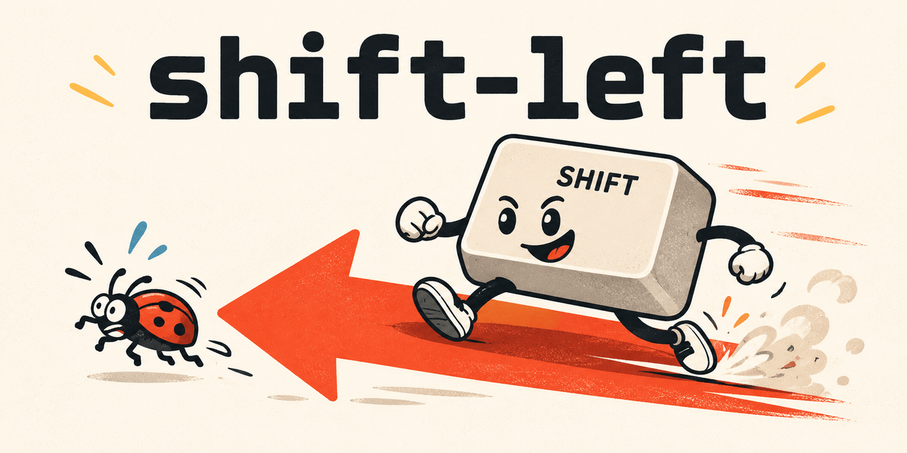

# shift-left

A marketplace, `shift-left`, with a few small plugins for coding agents, which bring
review quality forward to the moment code is written. Each plugin can be adopted
alone. The plugins are written for Claude Code and tested with it. The four that hold
skills, `principles`, `coordinator`, `workflow` and `learning`, are also packaged as
the Agent Plugins standard asks, version 1.0.0, and tests check that packaging. They
were not observed in any client of that standard:
[What works in which client](#what-works-in-which-client) says what is known of each
component, and on what evidence.



## Plugins

A skill or an agent is named below as Claude Code names it, `<plugin>:<name>`. Codex
lists a skill that the installer links under the same name (probe X3); how another
client names it to its agent is not known.

### `principles`

- The skill `principles:programming-principles`: sixteen design rules for clear,
  maintainable, verifiable code. Each rule has a guide with a definition, two worked
  examples and a review question, opened only when a decision depends on it.
- The skill `principles:karpathy-guidelines`: four guidelines against the common
  mistakes of a language model that writes code: think before coding, simplicity
  first, surgical changes, goal-driven execution. It is copied unchanged from another
  repository, under another licence: see the notice beside it.
- The agent `principles:principles-reviewer`: a fast, read-only review of one change
  against both skills, in one bounded pass. Its requirements lens is off unless the
  caller names it or gives a plan with acceptance criteria; it then checks the change
  against those criteria, with at most three findings of its own.

It needs nothing else.

### `quality-ratchet`

A hook that runs after each edit of a Python file. It runs Ruff with the repository's
own configuration, plus McCabe complexity and the bugbear rules, on the edited file and
on its committed version, and reports to the agent only the problems that the edit
introduced. A function that is already over the complexity threshold may not grow; it
is also reported when it is renamed, or when it shrinks and stays over the threshold.

It needs `python3` (3.14 or later) and `git` on `PATH`, and Ruff: the `.venv/bin/ruff`
of the repository being edited when there is one, otherwise the `ruff` on `PATH`.
Without Ruff the hook reports its own failure at each Python edit. For a file that is
new or outside a git repository, every problem counts as introduced.

The plugin is written for Claude Code and tested with it alone. Other clients are
documented to read its hook file all the same, one of them after every tool call:
see [What works in which client](#what-works-in-which-client). Nobody saw it.

### `basedpyright-lsp`

Type diagnostics after each edit and navigation by symbol for `.py` and `.pyi` files,
from the basedpyright language server.

It needs `basedpyright-langserver` on `PATH`. Do not enable `pyright-lsp` at the same
time, or diagnostics are reported twice.

The plugin is written for Claude Code and tested with it alone: its language server
is declared in an entry of the marketplace file, and no other client is known to
read it there.

### `coordinator`

The skill `coordinator:instrument`: two scripts that an agent runs from the directory
of the skill, so that what a plan cost and what its review found are read from data.

- `findings.py` keeps the findings of the reviews of one plan in one JSON file. One
  schema file, `finding.schema.json`, is the authority on the fourteen fields of a
  finding, on their values and on which role writes which: reviewer, fixer or
  coordinator. The script prints the schema of the answer of each role, rejects an
  answer that breaks the schema or a rule, and summarises the file. It writes a file
  whole or not at all, and only where git ignores it, since findings can quote
  private code.
- `minutes.py` reads the cost of ended workflow runs from the records that Claude
  Code keeps: wall minutes and agent minutes per stage, the agents that did not
  finish, and two bounds of the coordinator's minutes from the transcript of the main
  session.
- `codebook.md` defines the labels that a rater gives to a finding afterwards:
  category, origin, knowable and cheapest preventer.

It needs `python3` (3.14 or later) on `PATH`; `findings.py` also needs `git` and a
POSIX system. The shape of the run records and of the transcripts was observed with
Claude Code 2.1.288, see `docs/harness-facts.md`. `minutes.py` refuses a run record
in which a key that it reads is missing or has another type, and a transcript that
holds `user` or `assistant` records of which none starts a turn. It does not refuse a
value that it does not know: an entry of an unknown type is ignored, and an agent in
a state other than `done` counts as not finished. A later version of Claude Code that
renames such a value gives wrong figures, so see the facts again after an upgrade.

### `workflow`

The skill `workflow:plans`: how a change goes from a plan to a merge. One plan, one
branch and one linked worktree per change; small commits whose messages follow fixed
rules; an independent review, by the agent `principles:principles-reviewer` in Claude
Code where `principles` is installed, and otherwise in a fresh context; notes appended
to the plan; a merge only once the user confirms. A repository adopts it with a section
of its `AGENTS.md` that names the skill and gives the repository's own parameters:

```
## Workflow

Every change follows the skill `workflow:plans`; load it before the first edit. In
this repository: plans are `docs/work/plans/NNN-slug.<ext>`, tracked or not; the
checks are <commands>; the extra steps are <only what is specific here>.
```

It needs `git` and nothing else.

### `learning`

The skill `learning:learning-mode`: the agent teaches rather than does, so that each
task leaves the user able to do it alone. It reserves the meaningful decision for the
user, teaches with worked examples, asks one question at a time and waits, gives the
least help that moves the user forward, and checks independent performance before it
counts a skill as learnt. Only the user invokes it, as `/learning:learning-mode` in
Claude Code and VS Code and as `$learning:learning-mode` in Codex; VS Code shows a
skill linked in `~/.agents/skills`, rather than read from its plugin, by its bare
name, `/learning-mode`. It is never loaded by default, nor by the model on its own.
It applies from that invocation until the user ends it, except for a scope that the
user confirms is to be executed for them, and never where no user is in the
conversation.

It needs nothing else.

## Install

A command is printed here only where it was seen to work, with one exception, said
below. [What works in which client](#what-works-in-which-client) has a row for each
way to install.

### Every client, from a clone

`install.sh`, at the root of a clone, installs the plugins of clones of marketplaces
for the clients of the machine, and links `instructions/global.md` for them. With no
argument it takes the clone that holds it; other clones, of other marketplaces laid
out the same way, can be named. Of its own it makes links into the clones and nothing
else, so a commit reaches Codex through them at once. Run it again after each commit,
so that Claude Code takes the commit too. Its header says what it prints. It needs
`bash` (4.4 or later) and `python3` on `PATH`.

```
<clone>/install.sh
<clone>/install.sh <clone> <other clone>
```

What it does for each client, with the words of
[What works in which client](#what-works-in-which-client):

- Codex, *seen*: Codex CLI 0.163.0-alpha.10.2, 2026-10-16 (probe X of
  `docs/harness-facts.md`). Each skill is linked as `~/.agents/skills/<name>`, which
  Codex lists under the name of its plugin, as `principles:karpathy-guidelines`, and
  `instructions/global.md` as `AGENTS.md` of the Codex home, `~/.codex` or
  `CODEX_HOME`, which Codex reads as the user's instructions. An
  `AGENTS.override.md` beside that link is read in its place.
- Claude Code, *seen*: Claude Code 2.1.295, 2026-10-16 (probe C). Each clone is added
  as a marketplace, and each plugin installed, unless it is installed for the user
  already, then updated. The user-level `CLAUDE.md` is not edited: the script says
  whether it imports `instructions/global.md`, or is a link to it, and prints the line
  to add if neither. A linked `CLAUDE.md` was seen read through its link, but not in a
  Cowork session (probe L).
- VS Code, *by its documentation* for the plugins and *not known* for the
  instructions. One entry of the setting `chat.pluginLocations`, which its page
  documents (the row "Install from a path"), is printed per plugin, for you to add;
  the script writes no setting. `instructions/global.md` is linked as
  `~/.config/Code/User/prompts/shift-left.instructions.md`, in the user folder of VS
  Code on Linux, where nobody saw VS Code read it. Wherever VS Code can see
  `~/.agents/skills`, it reads the skill links too, *by its documentation*: the page
  "Agent Skills", `code.visualstudio.com/docs/agent-customization/agent-skills`, dated
  2026-10-14 and read on 2026-10-16, names that folder among those of the user's own
  skills. By its code, read in VS Code 1.140.0 and not seen at work
  (`docs/harness-facts.md`), a skill found there comes before the copy that a plugin
  brings, which is skipped, and keeps its bare name: `karpathy-guidelines`, where the
  plugin's copy is `principles:karpathy-guidelines`.

It refuses, says why and changes nothing when the place of a link is taken, as by a
skill of the same name in `~/.agents/skills` or in the skills of Codex, which Codex
would list twice (*seen*, probe X8), or by instructions of your own at either
instruction link: move them aside, then run it again. Its header lists every refusal.

A plugin that you disable in Claude Code stays disabled at the next run: the script
does not install it again. In Codex, a skill whose link you remove comes back at the
next run. Turn it off instead in `config.toml` of the Codex home, which the script
never touches, by the absolute path of its link, `<home>` being your home directory
(*seen*, probe X5):

```
[[skills.config]]
path = "<home>/.agents/skills/<name>/SKILL.md"
enabled = false
```

In VS Code, an entry of `chat.pluginLocations` set to `false` turns a plugin off, but
not its skills that the script links, which VS Code reads as your own. How to turn off
one of them there is not known: the page "Agent Skills" turns a skill off in the
skill's own front matter, a file of the clone. By its code,
`"~/.agents/skills": false` in the setting `chat.agentSkillsLocations`, which that
page calls deprecated and not read by the Copilot harness, turns off every skill
linked there.

### Claude Code

From GitHub, *not known*, and the one exception:

These commands are untested until this repository is first pushed. What was tested is
an install from a local clone and from a local git source.

```
claude plugin marketplace add piotr-yuxuan/shift-left
claude plugin install principles@shift-left
claude plugin install quality-ratchet@shift-left
claude plugin install basedpyright-lsp@shift-left
claude plugin install coordinator@shift-left
claude plugin install workflow@shift-left
claude plugin install learning@shift-left
```

The same commands recreate a user configuration on a new machine: they record the
marketplace and the enabled plugins in the user's `settings.json`.

From a local clone, *seen*: `claude plugin marketplace add <clone>` registers the
directory itself. A start of the CLI was then seen to read the plugins from the clone
in place, and a session of the desktop app from a copy made at install time. After a
change in the clone, refresh that copy to the commit of the clone, then restart the
session:

```
claude plugin update principles@shift-left
claude plugin update quality-ratchet@shift-left
claude plugin update coordinator@shift-left
claude plugin update workflow@shift-left
claude plugin update learning@shift-left
```

From a path, *seen*: one plugin directory, for one session, with no marketplace and
no install.

```
claude --plugin-dir <clone>/plugins/principles
```

### Other clients

No command of VS Code, GitHub Copilot CLI or Codex is printed: none was run. For
Codex and VS Code, the installer above makes links instead. Each documents how a
plugin is added, on the page that
[What works in which client](#what-works-in-which-client) names for it.

### If a hook wrongly blocks

Disable its plugin, and enable it again once the cause is fixed:

```
claude plugin disable quality-ratchet@shift-left
claude plugin enable quality-ratchet@shift-left
```

## Always-on instructions

`instructions/global.md` holds the owner's own user-level rules, written for every
client: the skills to load, code quality, commits and writing, and invariants such as
never pushing. Some parts are personal: the language register, the learning mode, and
the configuration folders that the invariants name. The file belongs to no plugin, so
installing a plugin does not bring it; adopt what fits.

### Claude Code

A plugin of Claude Code cannot ship instructions that load into every session. Clone
this repository, or copy the file, then import it from your user-level `CLAUDE.md`
with one line that gives its absolute path, here from a clone:

```
@<clone>/instructions/global.md
```

Claude Code's documentation, its memory page under "Import additional files" as it
was read on 2026-10-10, says that a user-level file imports without an approval
dialog, that a space in the path needs a backslash before it, and that Cowork sessions
skip such an import when the file lies outside their working directory.

### Other clients

The installer links this file where Codex reads the user's instructions, and Codex
was seen to read it there (probe X1); and into the user folder of VS Code, where
nobody saw it read. It begins with a front matter, `applyTo: "**"`, meant for VS
Code. Whether it serves another client as it is, is not known.

## What works in which client

`principles`, `coordinator`, `workflow` and `learning` each have a `plugin.json` at
their root, as Agent Plugins 1.0.0 asks (`agent-plugins.org/specification`, 4.1 and
5.2, read on 2026-10-11), beside the `.claude-plugin/plugin.json` that Claude Code
reads. Their skills follow Agent Skills (`agentskills.io/specification`, "SKILL.md
format", read on 2026-10-11). The tests in `tests/packaging/` check both. That is
packaging: of the clients below, only Claude Code was seen to load a plugin, and Codex
only what the installer links.

Each cell of the table holds one of five words.

- *seen*: a probe recorded in `docs/harness-facts.md` observed it in a running
  client. The cell gives the version of the client, the date, and the probe or the
  section of that file.
- *by the standard*: the component is one that Agent Plugins 1.0.0 defines, and the
  client is on *the list*, the standard's list of compatible clients,
  `agent-plugins.org/compatible-clients`, as it was read on the date given. Nobody
  tried it.
- *by its documentation*: the client's own page says what the client does with the
  component in the form that this repository ships, and nobody tried it. The cell
  says what the page says, and names the section and the date it was read.
- *no*: a probe saw that the client does not load or run it. No cell says so today.
- *not known*: none of these.

A cell that cites another page names it. *Its page* is, for each client, the page
below, read as page text:

- VS Code: "Agent plugins in VS Code",
  `code.visualstudio.com/docs/agent-customization/agent-plugins`, dated 2026-10-07.
- GitHub Copilot CLI: "GitHub Copilot CLI plugin reference",
  `docs.github.com/en/copilot/reference/copilot-cli-reference/cli-plugin-reference`.
- Codex: "Package your plugin", `developers.openai.com/plugins/build/plugins`.

Probe Q1 ran Claude Code against scratch configurations. Probe Q2a ran, outside VS
Code, the code of VS Code 1.140.0 that picks the format of a plugin and the
directories of its components: it shows what is read, never that a component works.
Both are recorded in `docs/harness-facts.md`.

| Component | Claude Code | VS Code | GitHub Copilot CLI | Codex |
|---|---|---|---|---|
| Skill `programming-principles` of `principles` | *seen*: Claude Code 2.1.288, 2026-10-10, in a session ("Skills that an agent names"); 2026-10-11, counted at a start (probe Q1) | *by the standard* (the list, 2026-10-11) | *by its documentation* (its page, "Components", 2026-10-11): skills are read from the immediate subdirectories of `skills/` of a plugin whose root manifest declares the standard | *by the standard* (the list, 2026-10-11) |
| Skill `karpathy-guidelines` of `principles` | *seen*: Claude Code 2.1.288, 2026-10-10, in a session ("Skills that an agent names"); 2026-10-11, counted at a start (probe Q1) | *by the standard* (the list, 2026-10-11) | *by its documentation* (its page, "Components", 2026-10-11): as above | *by the standard* (the list, 2026-10-11) |
| Skill `instrument` of `coordinator` | *seen*: Claude Code 2.1.288, 2026-10-11, counted at a start (probe Q1). No session has loaded it yet: the plugin was installed in scratch configurations only | *by the standard* (the list, 2026-10-11) | *by its documentation* (its page, "Components", 2026-10-11): as above | *by the standard* (the list, 2026-10-11) |
| Skill `plans` of `workflow` | *seen*: Claude Code 2.1.295, 2026-10-16, counted by `plugin details` ("Two plugins of one skill each"). No session has loaded it yet: the plugin was installed in a scratch configuration only | *by the standard* (the list, 2026-10-11) | *by its documentation* (its page, "Components", 2026-10-11): as above | *by the standard* (the list, 2026-10-11) |
| Skill `learning-mode` of `learning` | *seen*: Claude Code 2.1.295, 2026-10-16, counted by `plugin details` ("Two plugins of one skill each"). No session has loaded it yet: the plugin was installed in a scratch configuration only | *by the standard* (the list, 2026-10-11) | *by its documentation* (its page, "Components", 2026-10-11): as above | *by the standard* (the list, 2026-10-11) |
| `findings.py`, which an agent runs from the directory of the skill `instrument` | *not known*: no session has run it from an installed copy of the skill. That an agent is told the directory of a skill and can run the files beside it was seen with a skill of another plugin ("Scripts that a skill brings") | *not known*: how the client tells its agent the directory of a skill is not established | *not known*, for the same reason | *not known*, for the same reason |
| `minutes.py`, run in the same way | *not known*, as for `findings.py`. The records that it reads were seen ("Workflow runs and transcripts") | *not known*. It reads records that only Claude Code writes, so there is nothing for it to read | *not known*, for the same reason | *not known*, for the same reason |
| The reviewer agent of `principles`, `agents/principles-reviewer.md`, in Claude Code's format | *seen*: Claude Code 2.1.288, 2026-10-10, in a session of the desktop app ("Skills that an agent names"); 2026-10-11, counted at a start (probe Q1) | *by its documentation* (its page, "Plugin formats", "Plugin manifest (plugin.json)" and "Reference plugin paths in hook commands", 2026-10-11; probe Q2a): read from `agents/`, in Claude format, while the plugin had only Claude Code's manifest; no longer read now that the root manifest is there, since agents then come from `com.github.copilot/agents/` alone. Read is not shown to work: nobody saw the agent run there | *by its documentation* (its page, "File locations" and "Components", 2026-10-11): read from `agents/`, as a legacy plugin, while the plugin had only Claude Code's manifest; no longer read now that the root manifest is there, since it takes precedence and agents then come from `com.github.copilot/agents/`. Nobody saw the agent run there | *not known* |
| The hook of `quality-ratchet`, `hooks/hooks.json`, written for Claude Code's event | *seen*: Claude Code 2.1.288, 2026-10-10, in sessions of the desktop app ("Hooks"); 2026-10-11, read at a start (probe Q1) | *by its documentation* (its page, "Plugin formats", "Hook file location" and "Hook configuration format", 2026-10-11; probe Q2a): the plugin has no root manifest, so it is read in Claude format, with `hooks/hooks.json`; the Local harness ignores the value of a matcher, so the command runs after every tool call and not only after an edit. Not tried | *by its documentation* (its page, "File locations", 2026-10-11): read as a legacy plugin, with `hooks/hooks.json`. Not tried | *by its documentation* (its page, "Bundled MCP servers and lifecycle hooks", 2026-10-11): `hooks/hooks.json` is discovered by default, for a plugin installed by hand in the desktop app, and skipped until the user trusts it. Not tried |
| The language server of `basedpyright-lsp`, an entry of the marketplace file | *seen*: Claude Code 2.1.288, 2026-10-10 ("Where a plugin is loaded from"); 2026-10-11, loaded at a start (probe Q1) | *not known*. The bundle of VS Code 1.140.0 that reads a marketplace file nowhere names the field `lspServers`, which declares it; a bundle of its built-in extension `copilot` does (probe Q2a) | *not known*. Its page ("LSP server configuration", 2026-10-11) requires `fileExtensions` of a language server, where the entry has `extensionToLanguage` | *not known* |
| `instructions/global.md` | *seen*: Claude Code 2.1.288, 2026-10-10 ("Instructions"): imported by the user-level `CLAUDE.md` | *not known*: see "Always-on instructions" | *not known* | *seen*: Codex CLI 0.163.0-alpha.10.2, 2026-10-16 (probe X1): read as the user's instructions through a link at `AGENTS.md` of the Codex home, which the installer makes |
| The marketplace file, `.claude-plugin/marketplace.json` | *seen*: Claude Code 2.1.288, 2026-10-11 (probe Q1) | *by its documentation* (its page, "Configure plugin marketplaces", 2026-10-11; probe Q2a): a marketplace is a git repository named in the setting `chat.plugins.marketplaces`, and the page sends to Claude Code's documentation for the schema of its entries; the files of VS Code try this path last of four. Not tried | *by its documentation* (its page, "File locations" and "Plugin source types", 2026-10-11): this path is the last of four that it checks, and a source may be a relative path. Not tried | *by its documentation* (its page, "How local marketplaces work" and "Marketplace metadata", 2026-10-11): read as a legacy-compatible marketplace; a source may be a plain path; the page asks each entry for a policy and a category, which these entries lack. Not tried |
| Install from GitHub | *not known*, until this repository is first pushed: see "Install" | *by its documentation* (its page, "Configure plugin marketplaces" and "Install a plugin from source", 2026-10-11): `owner/repo` in the setting `chat.plugins.marketplaces`, or a command that takes the address of a git repository. Not run | *by its documentation* (its page, "Plugin specification for install command", 2026-10-11): a plugin of a registered marketplace, or a subdirectory of a repository on GitHub. Not run | *by its documentation* (its page, "Add a marketplace from the CLI", 2026-10-11): a marketplace is added from `owner/repo`, and the page sends the install and the test of a plugin to the desktop app. Not run |
| Install from a local clone | *seen*: Claude Code 2.1.288, 2026-10-10 ("Where a plugin is loaded from") and 2026-10-11 (probe Q1) | *by its documentation* (its page, "Configure plugin marketplaces", 2026-10-11): a `file:///` address of the clone in the setting `chat.plugins.marketplaces`. Not run | *not known* | *by its documentation* (its page, "Add a marketplace from the CLI", 2026-10-11): the root directory of a local marketplace. Not run |
| Install from a path, one plugin directory | *seen*: Claude Code 2.1.288, 2026-10-11 (probe Q1): for one session, with `--plugin-dir` | *by its documentation* (its page, "Use local plugins", 2026-10-11): the setting `chat.pluginLocations`. Not run | *by its documentation* (its page, "Plugin specification for install command", 2026-10-11): a local path. Not run | *not known* |
| Install with `install.sh`, from a clone | *seen*: Claude Code 2.1.295, 2026-10-16 (probe C): the commands that it runs, run one by one; each plugin is installed and read from the clone | *by its documentation* for the plugins (its page, "Use local plugins", 2026-10-11): it prints an entry of the setting `chat.pluginLocations` per plugin, for you to add. Not run. *not known* for `instructions/global.md`, which it links into the user folder of VS Code. The skill links are read too, ahead of the plugins' copies, by the page "Agent Skills" (2026-10-16) and by the code of VS Code 1.140.0: see "Install" | *not known*: the script does nothing for this client | *seen*: Codex CLI 0.163.0-alpha.10.2, 2026-10-16 (probes X1 and X3): the skills and `instructions/global.md`, through links like those that it makes |

The other clients on the list as it was read on 2026-10-11, OpenHands, NanoClaw, Grok
Bot, Cursor, OpenClaw, Hermes Agent and Kiro, with ChatGPT, which the list names in one
entry with Codex, and GitHub Copilot outside its CLI, have the five skills *by the
standard* and every other row *not known*.

## Versions and releases

`.version` holds the version of this repository, that is of the marketplace, and
nothing else: `MAJOR.MINOR.PATCH` and a line break.

Each push to `main` that passes the gate becomes a release, with no hand involved. The
pipeline raises the patch number in a commit titled `Version X.Y.Z`, and makes on that
commit the tag and the release `X.Y.Z`. The notes of the release are the titles of
the commits since the release before, merges left out. A deployment record of the tag,
in the environment `release`, says which commit a client now fetches.

No `.claude-plugin/plugin.json` carries a version: for Claude Code the commit is the
version of a plugin, and each release is a new commit. So one command takes a release
of `principles`, `quality-ratchet`, `coordinator`, `workflow` or `learning`:

```
claude plugin update <plugin>@shift-left
```

The entry of `basedpyright-lsp` in the marketplace file keeps a version of its own,
1.0.0. A release does not move that plugin: the same command answers that it is
already at the latest version.

## Licence

EUPL 1.2, see `LICENSE`. One file is under MIT: the skill `karpathy-guidelines` of the
`principles` plugin, as the notice beside it says.
